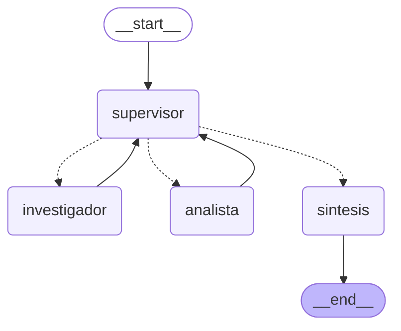

# Orquestador multi-agente especializado

Prototipo de un orquestador de análisis e investigación con LangGraph. Un **Supervisor** recibe la consulta y delega en dos especialistas: un **Investigador**, que busca en la documentación de FastAPI (Vector DB de la Pre-entrega 4), y un **Analista**, que valida datos JSON contra un esquema. Al final, una fase de **síntesis** combina los aportes en la respuesta.

Pre-entrega 6 — IA Engineering.

## Diagrama del grafo



Generado con `graph.get_graph().draw_mermaid()`. Las flechas punteadas son aristas condicionales: el supervisor decide el destino. Las sólidas son fijas: los especialistas siempre vuelven al supervisor.

## Componentes

| Archivo | Rol |
|---|---|
| `state.py` | Estado compartido (`AgentState`, hereda de `MessagesState`) |
| `agents/supervisor.py` | Router inteligente con rúbrica de validación y límite de pasos |
| `agents/research_agent.py` | Investigador. Herramienta: `buscar_documentacion_fastapi` (RAG híbrido BM25 + Pinecone) |
| `agents/analyst_agent.py` | Analista. Herramienta: `validar_json_contra_esquema` (Pydantic) |
| `agents/synthesis.py` | Fase de síntesis: redacta la respuesta final con los aportes |
| `graph.py` | Construcción del `StateGraph` y la función de ruteo con `Literal` |
| `main.py` | Demo en consola del flujo de delegación |
| `demo.ipynb` | Notebook que demuestra el flujo de delegación |
| `rag_system.py`, `config.py` | Recuperador híbrido de la Pre-entrega 4, reutilizado sin cambios de lógica |

### Estado compartido

```python
class AgentState(MessagesState):
    next_agent: Optional[str]      # decisión del supervisor
    instruccion: str               # tarea puntual para el próximo especialista
    contribuciones: Annotated[list[Contribucion], operator.add]
    pasos: int                     # intervenciones de especialistas
    task_completed: bool
```

`contribuciones` usa `operator.add` como reducer: cada especialista **suma** un registro `{agente, instruccion, aporte, paso}` en lugar de pisar los anteriores. Así queda rastreado qué agente aportó qué información y en qué orden, sin depender de reconstruirlo desde los mensajes.

## Topología elegida: jerárquica

El proceso tiene una dependencia clara: el analista no puede validar sin el esquema que encuentra el investigador. Una topología jerárquica encaja porque:

- **Control centralizado:** el supervisor es el único que decide el orden, así que no hay que coordinar a los especialistas entre sí.
- **Validación antes de terminar:** todo aporte vuelve al supervisor, que lo evalúa con una rúbrica antes de dar el END.
- **Trazabilidad:** cada delegación queda registrada como mensaje del supervisor, con su evaluación e instrucción.
- **Especialistas simples:** cada agente tiene un solo rol y una sola herramienta (herramientas acotadas). El investigador no puede validar y el analista no puede buscar.
- **Escalable:** sumar un especialista nuevo implica agregar un nodo y describirlo en el prompt del supervisor, sin tocar a los demás.

Una topología cooperativa (agentes que se pasan el trabajo entre pares) no aporta valor acá: no hay debate ni creación abierta, y sería más difícil garantizar que el proceso termine.

## Supervisión y validación

El supervisor usa salida estructurada (`DecisionSupervisor`) con tres campos: `evaluacion`, `next` (`Literal["investigador", "analista", "FINISH"]`) e `instruccion`. El campo `evaluacion` va primero para que el modelo aplique la rúbrica **antes** de decidir.

Rúbrica del prompt:

1. **Datos:** el investigador encontró todo lo necesario y citó la fuente.
2. **Análisis:** el analista validó todos los JSON pedidos.
3. **Consistencia:** el análisis usa el mismo esquema que encontró el investigador.
4. **Suficiencia:** si se cumplen 1 a 3, `FINISH`. Solo se pide refinar si falta información o hay un error, no por estilo.

Si un aporte no cumple, el supervisor vuelve a delegar en el mismo especialista con una instrucción que dice qué falta (refinamiento).

## Errores comunes y cómo se evitan

- **Supervisor infinito:** `MAX_PASOS = 6` intervenciones. Al alcanzarlo, el supervisor fuerza la síntesis sin consultar al LLM. Además, `recursion_limit = 25` como techo del grafo completo. A eso se suma el criterio de suficiencia de la rúbrica.
- **Caídas del proveedor:** cada nodo tiene un `RetryPolicy` que lo reintenta hasta 4 veces (esperando 5s, 10s, 20s) si Gemini devuelve un error de servidor (500/503, "high demand"). No reintenta el 429 de cuota agotada, porque eso no se resuelve esperando unos segundos.
- **Contaminación de contexto:** los especialistas no reciben el historial. El investigador recibe solo la instrucción del supervisor; el analista, la instrucción más el último aporte del investigador (el esquema que necesita). El supervisor ve la consulta original y las contribuciones, no los razonamientos internos de cada agente.

## Manejo de conflictos entre agentes

- **Un único árbitro:** los especialistas nunca se comunican directamente. Si sus aportes se contradicen, el supervisor detecta la inconsistencia (punto 3 de la rúbrica) y manda a corregir al agente cuyo aporte no coincide con la documentación.
- **La documentación es la fuente de verdad:** el analista no busca información y el investigador no valida. Cada dato tiene un único responsable.
- **Decisiones con herramientas, no a ojo:** la validación la hace Pydantic, no el LLM, así el resultado es reproducible.
- **Registro de aportes:** como `contribuciones` guarda cada intervención con su paso, si un agente corrige su aporte queda el historial completo y se toma como vigente el más reciente.

## Cómo levantar el entorno

Requisitos: Python 3.12+, una API key gratuita de Gemini ([aistudio.google.com/apikey](https://aistudio.google.com/apikey)) y el índice `fastapi-docs-rag` de la Pre-entrega 4 ya cargado en Pinecone.

```bash
python -m venv .venv
source .venv/Scripts/activate   # Git Bash en Windows
# .venv\Scripts\activate        # PowerShell / CMD
# source .venv/bin/activate     # Mac / Linux
pip install -r requirements.txt
```

1. Copiar `.env.example` como `.env` y completar `GOOGLE_API_KEY` y `PINECONE_API_KEY`.


## Ejecución

```bash
python main.py
```

O abrir `demo.ipynb` y ejecutar las celdas en orden.

La consulta de ejemplo obliga a usar los dos dominios:

> Según la documentación de FastAPI, ¿qué campos tiene el modelo Item del tutorial de Request Body y cuáles son obligatorios? Con ese esquema, validá si estos JSON serían aceptados: `{"name": "Teclado", "price": 45.2}` y `{"description": "Sin nombre", "price": "barato"}`.

Flujo esperado: supervisor → **investigador** (busca el esquema en `body.md`) → supervisor → **analista** (valida: el primero es válido; el segundo no, porque falta `name` y `price` no es un número) → supervisor → **síntesis** → END.
